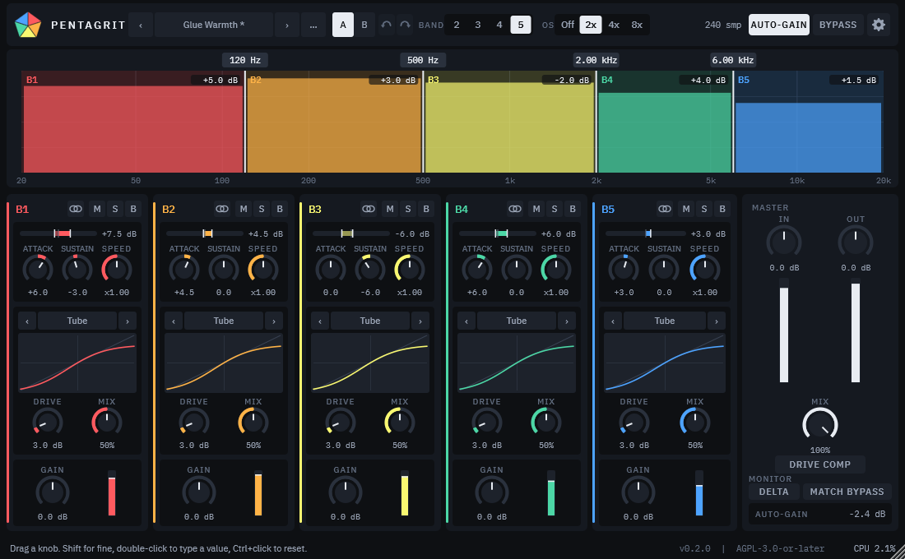
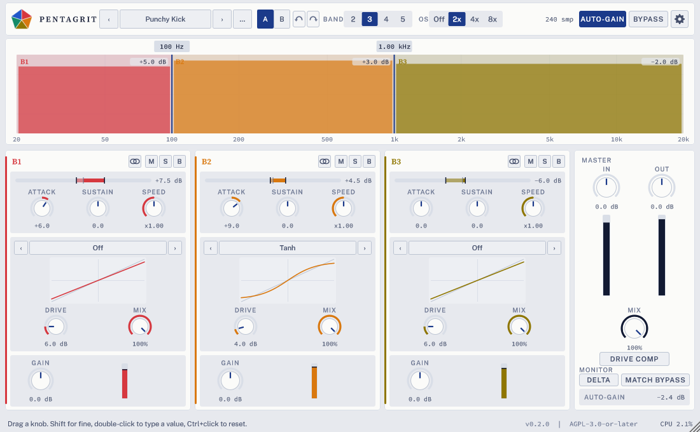

# Pentagrit

Multiband transient shaper and saturator plugin (VST3, CLAP, AU, Standalone) built with JUCE 8 and C++20: split the signal into 3 to 5 bands, then shape the attack and sustain and add saturation to each band separately.



Status: `v0.2.0` is the current stable release (see the [changelog](CHANGELOG.md)). The repository is public. License: AGPL-3.0-or-later.

## Features

- 3 to 5 band multiband processing with Linkwitz-Riley 4th order (LR4) crossovers (default 3 bands, 120 / 1200 / 3500 / 8000 Hz).
- Per-band transient shaper (attack and sustain, adjustable speed), with an optional lookahead (Off / 1 / 2 / 5 ms, adds its time to the reported latency).
- Per-band saturation with several curves (tanh, soft clip, tube, wavefold, hard clip) and drive. Hard clip and wavefold are antialiased (first-order ADAA).
- Optional drive compensation: keeps the level of quiet signals constant while the drive is raised.
- Auto-gain, global dry/wet mix with phase-matched dry path, per-band mute, solo and bypass.
- Oversampling (linear or minimum phase) with a separate render quality for offline bounces.
- Factory and user presets, A/B compare.
- Undo and redo for parameter changes (top bar buttons, Ctrl/Cmd+Z, Ctrl/Cmd+Shift+Z or Ctrl+Y).
- Typed values: double-click a knob to type a value (for example `50 %`, `1.2k`, `-3`); Ctrl+click (Cmd+click on macOS) resets to the default.
- Settings panel: zoom, six visual styles, Full or Compact layout, knob behaviour and value step, meters, preset folder and startup preset.
- Opt-in update check against GitHub Releases (Windows and macOS, off by default, at most once a day). It only reports stable releases.

New in `v0.2.0`:

- Per-band gain-change meters: a bipolar meter of the transient shaper's gain at the top of every band strip, with hold markers.
- Delta monitoring: listen to only what the plugin changes.
- Level-matched bypass: A/B compares tone, not volume.
- Band link: link bands so a knob move on one moves the same knob on the others (one undo step).
- A tooltip on every control, and a short [user guide](docs/GUIDE.md).
- CLAP validated with clap-validator on every platform in CI.

Formats: VST3 and CLAP on Windows, macOS and Linux; AU on macOS; plus a Standalone app.

New to Pentagrit? Read the [user guide](docs/GUIDE.md).



## Audio examples

Each row is a factory preset applied to the same dry source. GitHub plays the files when you click a link (or download them): they are Ogg Vorbis, about 10 seconds each. Headphones help.

| Preset | Dry | Processed |
|---|---|---|
| Punchy Kick | [dry](docs/audio/drumloop-punchy-kick-dry.ogg) | [processed](docs/audio/drumloop-punchy-kick-processed.ogg) |
| Snare Snap | [dry](docs/audio/drumloop-snare-snap-dry.ogg) | [processed](docs/audio/drumloop-snare-snap-processed.ogg) |
| Bass Grit | [dry](docs/audio/drumloop-bass-grit-dry.ogg) | [processed](docs/audio/drumloop-bass-grit-processed.ogg) |
| Glue Warmth | [dry](docs/audio/drumloop-glue-warmth-dry.ogg) | [processed](docs/audio/drumloop-glue-warmth-processed.ogg) |
| Wavefold Shimmer | [dry](docs/audio/drumloop-wavefold-shimmer-dry.ogg) | [processed](docs/audio/drumloop-wavefold-shimmer-processed.ogg) |

The source is a synthetic drum loop generated in code by `tests/DocsAssetsTests.cpp`, so it carries the project's licence (AGPL-3.0-or-later). Regenerate the screenshots and examples with `scripts/dev/make_docs_assets.sh` (see `docs/DEVELOPMENT.md`).

## Install

Builds are published on the [releases page](https://github.com/ivanerricis/pentagrit/releases). The current stable release is `v0.2.0`. Release candidates are listed there as pre-releases.

### Windows (installer)

Download `Pentagrit-vX.Y.Z-windows-setup.exe` from the release you want, run it (administrator rights required), and choose the components: VST3, CLAP and/or the Standalone app. The installer is not code-signed yet, so Windows SmartScreen may show "Windows protected your PC": click **More info**, then **Run anyway**. To uninstall, use **Settings, Apps, Installed apps, Pentagrit**.

### macOS (installer)

Download `Pentagrit-vX.Y.Z-macos.pkg` and open it. It is not signed or notarized yet, so Gatekeeper blocks a plain double-click: right-click the file and choose **Open**, or go to **System Settings, Privacy & Security, Open Anyway**. Pick the components (VST3, CLAP, Audio Unit, Standalone). To uninstall, delete `/Library/Audio/Plug-Ins/VST3/Pentagrit.vst3`, `/Library/Audio/Plug-Ins/CLAP/Pentagrit.clap`, `/Library/Audio/Plug-Ins/Components/Pentagrit.component` and `/Applications/Pentagrit.app`.

### Manual install (zip / tar.gz, all platforms)

Every release also contains a zip per platform (and a `.tar.gz` on Linux). Copy the plugin bundles to the standard locations:

| Format | Windows | macOS | Linux |
|---|---|---|---|
| VST3 | `C:\Program Files\Common Files\VST3` | `/Library/Audio/Plug-Ins/VST3` or `~/Library/Audio/Plug-Ins/VST3` | `~/.vst3` |
| CLAP | `C:\Program Files\Common Files\CLAP` | `/Library/Audio/Plug-Ins/CLAP` or `~/Library/Audio/Plug-Ins/CLAP` | `~/.clap` |
| AU | n/a | `/Library/Audio/Plug-Ins/Components` or `~/Library/Audio/Plug-Ins/Components` | n/a |

Verify downloads with `SHA256SUMS.txt` from the same release (`sha256sum -c SHA256SUMS.txt`, or `shasum -a 256 -c` on macOS).

### macOS: Gatekeeper quarantine

Builds are ad-hoc signed (not notarized yet, see `docs/MACOS_SIGNING.md`). If a plug-in installed from the zip does not load, remove the quarantine flag:

```
xattr -dr com.apple.quarantine /path/to/Pentagrit.vst3
```

Repeat for the `.component`, `.clap` and `.app` bundles. If an AU does not show up, run `killall -9 AudioComponentRegistrar` and rescan.

## Build from source

Requirements: CMake >= 3.25, a C++20 compiler (Visual Studio 2026 on Windows, Xcode on macOS, GCC/Clang on Linux), Git. Dependencies are fetched with CPM.

On Windows:

```
set CPM_SOURCE_CACHE=C:\dev\.cpm
cmake --preset win-vs
cmake --build --preset win-vs-release
ctest --preset win-vs-release
```

Other presets: `win-ninja` (from a VS developer prompt), `mac-universal`, `linux`.

Tips:

- Set `CPM_SOURCE_CACHE` to a shared folder to avoid re-downloading JUCE and friends in every checkout or worktree.
- Keep the checkout path short (for example `C:\dev\pentagrit`): deep paths can exceed the Windows 260-character limit during the build.

See `docs/DEVELOPMENT.md` for the full developer guide, `docs/ARCHITECTURE.md` for the frozen contracts and `CONTRIBUTING.md` for how to contribute.

## License

Pentagrit is licensed under the GNU Affero General Public License v3.0 or later (see `LICENSE`). Third-party components and their licences are listed in `THIRD_PARTY_NOTICES.md`.
